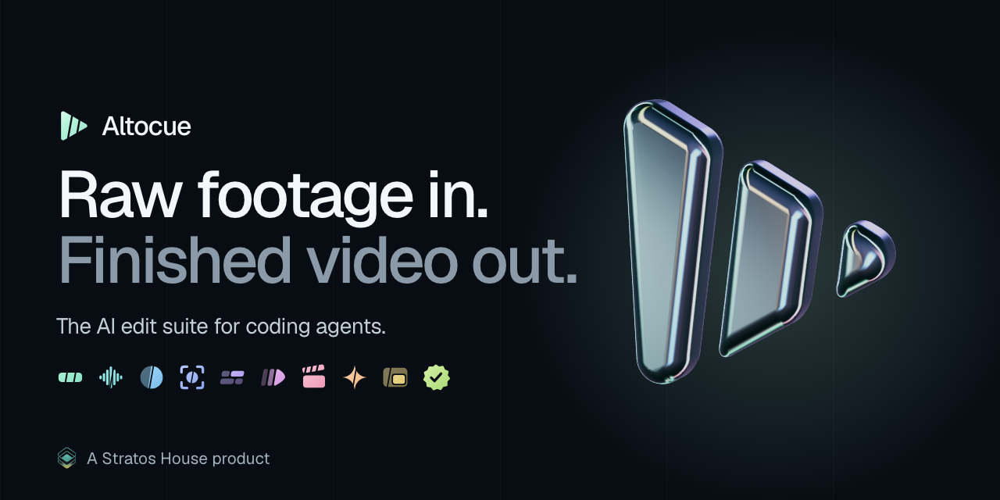
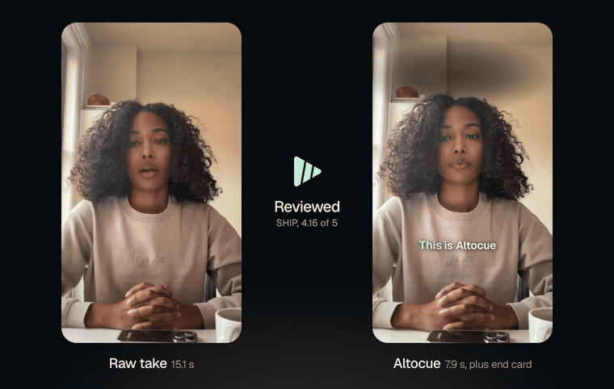
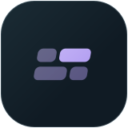
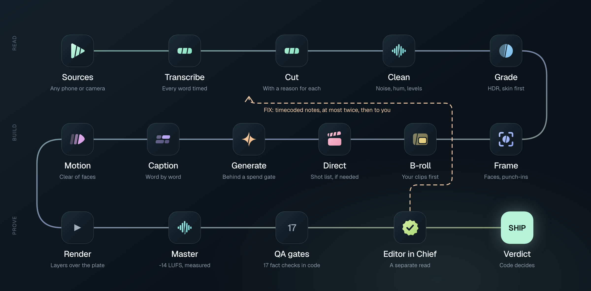

<div align="center">
  <a href="https://github.com/StratosHouse/altocue"></a>

  <h1>Altocue</h1>

  <p><strong>The AI edit suite for coding agents.</strong><br>
  It cuts, cleans, grades, captions and directs. Then a separate Editor in Chief has to sign off.</p>

  <p>
    <a href="#install"></a>
    <a href="#install"></a>
    <a href="LICENSE"></a>
    <a href="LICENSES.md"></a>
    <a href="https://www.stratosagency.ai/altocue"></a>
    <a href="https://www.stratosagency.ai"></a>
  </p>
</div>

<div align="center"></div>

<p align="center"><sub>The presenter is AI-generated with Higgsfield. The mistakes are planted. The edit is real.</sub></p>

## What it does

You hand your coding agent a messy recording. Altocue gives it the eyes and ears to edit properly.

- **It reads every word.** Word-timed transcripts with fillers kept, so cuts land on real speech.
- **It writes down every decision.** Each removal has a reason in a file you can read and overrule.
- **It finishes the job.** Clean sound, correct colour, framing, B-roll, captions and motion graphics.
- **It does not mark its own homework.** A separate reviewer scores the final, on another vendor if you opt in, and code decides SHIP or FIX.

## Install

You need [uv](https://docs.astral.sh/uv/) and ffmpeg. Stock Homebrew or apt ffmpeg is fine. On Linux, add tesseract so QA can read text in the picture. Motion graphics need Node 22 or later. 16 GB of memory is comfortable, and it needs about 3.5 GB of disk: 2.5 GB for the speech model, the rest for the tool and its renderer.

```bash
uv tool install git+https://github.com/StratosHouse/altocue
altocue setup
```

`setup` asks before it installs anything: the motion renderer and a better noise remover. Both are optional. `altocue setup --yes` says yes to both.

**In Claude Code:**

```text
/plugin marketplace add StratosHouse/altocue
/plugin install altocue@altocue
```

**In Codex:** clone this repo and ask Codex to follow [INSTALL.md](INSTALL.md). It reads the skills in `.agents/skills`.

**Any other agent:** point it at [INSTALL.md](INSTALL.md) and `skills/altocue/SKILL.md`.

## Use it

Ask your agent:

```text
Edit take.mov into a 45 second reel for first-time founders.
```

Or drive it yourself:

<div align="center"></div>

```bash
altocue new my-video --input take.mov --aspect 9:16 --brief "A reel for first-time founders"
cd my-video
altocue run
```

`altocue run` stops before review. Read `work/cut-review.md`, rule on anything it could not decide with `altocue cut --apply-review decisions.json`, then run `altocue run` again. When QA passes, run `altocue review`.

## The tools

<table>
  <tr>
    <td width="33%"><br><strong>Cut</strong><br>Silence, fillers, stutters and retakes go. Edges snap to real speech. No cut lands inside a word.</td>
    <td width="33%"><br><strong>Clean</strong><br>Noise and hum out, voices levelled, mastered to a measured loudness and true peak.</td>
    <td width="33%"><br><strong>Grade</strong><br>iPhone HDR to SDR. White balance and exposure anchored on the face. Skin comes first.</td>
  </tr>
  <tr>
    <td><br><strong>Frame</strong><br>Any aspect ratio. Face-aware crops per shot, with punch-ins that hide jump cuts.</td>
    <td><br><strong>Caption</strong><br>Word-by-word highlight. Never crosses a cut. Only shows words really said.</td>
    <td><br><strong>Motion</strong><br>Hooks, lower thirds, stats, steps and end cards, timed to speech and placed clear of faces.</td>
  </tr>
  <tr>
    <td><br><strong>Direct</strong><br>Story shape, beats, keyframes and shot lists, with the craft rules built in.</td>
    <td><br><strong>Generate</strong><br>Inserts through Higgsfield and fal.ai, behind a spend gate. Every asset keeps its provenance.</td>
    <td><br><strong>B-roll</strong><br>Finds the spots that want a cutaway, then fills them from your clips, free stock or generation.</td>
  </tr>
  <tr>
    <td colspan="3"><br><strong>Review</strong><br>A separate Editor in Chief scores the final. Code decides SHIP or FIX.</td>
  </tr>
</table>

## How it works

<div align="center"></div>

Every stage reads and writes plain files, so you or your agent can step in anywhere. The picture and sound edit is built with ffmpeg. Graphics render as a transparent layer on top, so changing a caption never re-encodes the edit.

## The Editor in Chief

The editor never signs off their own work.

1. **Fact gates in code.** Loudness, true peak, black and frozen frames, duration, sound at every cut, words heard against words expected, captions, safe zones, text and graphics on faces. Any failure is an automatic FIX, with no model call.
2. **A separate reviewer.** Gemini watches the actual video, or Codex reads the review pack. It gets the film, the brief, the rubric and a note of anything planned on purpose, such as an end card. It never sees the reasons for a cut. With neither turned on, a fresh agent reviews the pack and the report says it is not independent.
3. **Code decides.** The reviewer only scores. SHIP needs every gate passing, nothing under 3, a weighted score of 3.8 or more and no blocker. Notes without a valid timecode are thrown away, unless they claim a blocker, which forces another look.
4. **Two rounds, then you.** After two rounds of fixes, the open list goes to a human.

The gates caught 20 of 20 planted faults in our canary set, with no false alarms on 5 clean controls. The demo above failed its first review because a caption overlapped at a cut. The tool was fixed, the film was rendered again, and it passed. It now scores 4.16 of 5.

Every report ends with what the reviewer could not see or hear. Skipped checks are shown as skipped, never as passed.

## What it costs

Altocue is free. Hosted providers are optional, off by default, and billed by them on your own key.

| Stage | Local, free | Optional hosted |
|---|---|---|
| Transcription | Parakeet on Apple Silicon, faster-whisper elsewhere | ElevenLabs Scribe |
| Noise removal | DeepFilterNet or ffmpeg | |
| Graphics | HyperFrames or the built-in basic renderer | |
| B-roll | Your own clips | Pexels and Pixabay with a free key |
| Generation | | fal.ai, Higgsfield |
| Review | A fresh agent with the review pack | Gemini, Codex |

Altocue has no telemetry. Your coding agent reads transcripts and frames, so those reach its vendor. Paid generation shows its cost and waits for a yes. Anything that uploads names where it is going first. Stock search sends only the search words.

## Honest limits

- **Auto-reframe is per shot.** A static crop cannot follow someone walking across the frame.
- **Clean-up cannot rescue bad audio.** Clipping, heavy echo and loud music stay.
- **Retake detection has a small test set.** Anything uncertain waits for a ruling.
- **Word match can read low on noisy footage.** Off-mic speech and unusual names bring it down.
- **Spelling needs you.** The transcript can mishear names. Add them under `[transcribe.fix]`.
- **A gate that could not run blocks SHIP.** On a machine with no transcriber, the verdict stays FIX. Gates that do not apply, such as rules with no rules file, show as n/a.
- **Some hosted paths are not proven live yet.** Higgsfield has run for real through its MCP server and `generate --import`. Its CLI route, fal.ai, Gemini and stock search are tested against fake servers. Report what you find.
- **Some transcribers drop fillers.** Parakeet can miss an "um". The pause still goes, but the report calls it silence.
- **It is a heavy job.** Transcribing takes about 4 GB of memory and renders use every core. Altocue runs one heavy job at a time per machine, and a second one waits its turn.

## Licence

Altocue is [MIT](LICENSE). Every required dependency is open source, so a team of any size can use it with no licence fee. See [LICENSES.md](LICENSES.md).

<div align="center"><br><a href="https://www.stratosagency.ai"></a><br><sub>A Stratos House product</sub></div>
