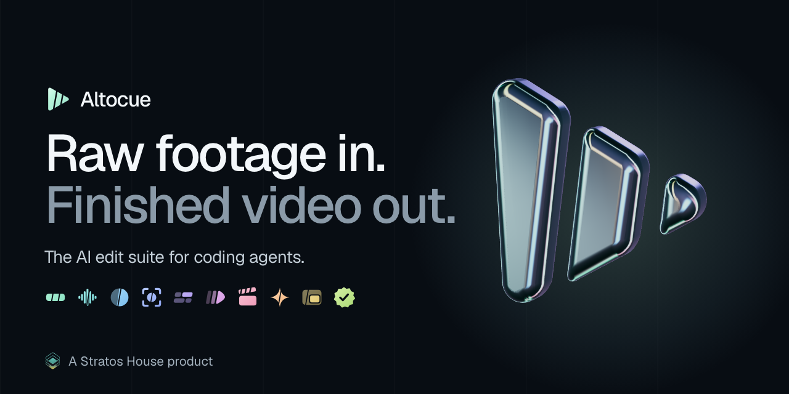
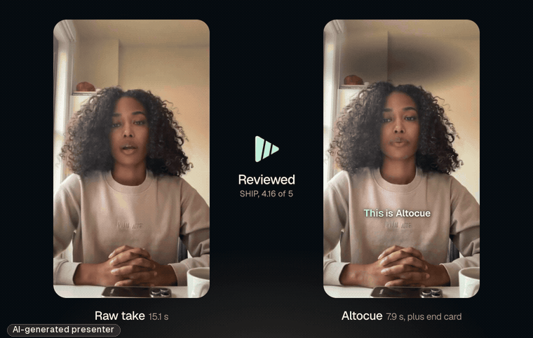
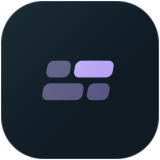
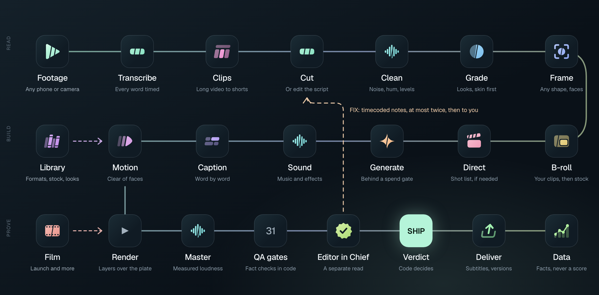

<div align="center">
  <a href="https://github.com/StratosHouse/altocue"></a>

  <h1>Altocue</h1>

  <p><strong>The AI edit suite for coding agents.</strong><br>
  A full open video editing suite your agent drives. It cuts, cleans, grades, captions, animates, adds sound and delivers, and it makes films with no footage at all. Then a separate Editor in Chief has to sign off.</p>

  <p>
    <a href="#install"></a>
    <a href="#install"></a>
    <a href="#install"></a>
    <a href="#install"></a>
    <a href="https://pypi.org/project/altocue/"></a>
    <a href="https://github.com/StratosHouse/altocue/blob/main/LICENSE"></a>
    <a href="https://github.com/StratosHouse/altocue/blob/main/LICENSES.md"></a>
    <a href="https://www.stratosagency.ai/altocue"></a>
    <a href="https://www.stratosagency.ai"></a>
  </p>
</div>

<div align="center"></div>

<p align="center"><sub>The presenter is AI-generated with Higgsfield. The mistakes are planted. The edit is real.</sub></p>

> **Making a launch video?** There is a dedicated feature for it, and a skill that runs it from the brief to the finished film. It needs no footage, no filming and no keys:
>
> ```bash
> altocue launch my-launch --product "Name"
> ```
>
> Or ask your agent for a launch video. The `altocue-launch` skill picks it up. See [Films with no footage](#films-with-no-footage).

## What it does

You hand your coding agent a messy recording, a long talk or just a brief. Altocue gives it the eyes, ears and tools to finish the job.

- **Cutting.** Word-timed transcripts with fillers kept, so cuts land on real speech. Each removal has a reason you can overrule. Or edit the script and get a frame-safe cut.
- **Sound.** Noise and hum out, each phrase levelled, room tone in the holes, mastered to a measured loudness and true peak.
- **Colour.** HDR to SDR, white balance and exposure read from the face, film looks or your own LUT, with skin protected.
- **Captions.** Word by word, never across a cut, only words really said. Speakers can be named or coloured.
- **Motion graphics.** 151 original formats in 12 groups, timed to speech and placed clear of faces. The Studio collection adds smooth typography, depth, linked handoffs, editing diagrams and endings.
- **Copyable motion recipes.** Every built-in graphic includes an agent prompt, a native example and optional sound notes. Preview the full library and adapt it to your words.
- **Music and effects.** Sound you are allowed to use, with the licence and credit shown before anything downloads.
- **Films with no footage.** Launch films, explainers, demos, ad cards and more, drawn in code from a storyboard.
- **Long video to shorts.** It finds complete thoughts in your own recordings and cuts each into its own project.
- **Deliverables.** Subtitles, chapters, thumbnails, stems, a version with no music for an app's own song library, and a version for each platform, with the master untouched.
- **Data checks.** It measures the finished film and learns from your own results. It predicts nothing.
- **The Editor in Chief.** It does not mark its own homework. Fact gates in code, then a separate reviewer, then code decides SHIP or FIX.

## Install

Add Altocue to your agent as a plugin, then ask the agent to set it up. It checks the machine, asks before it installs anything, and proves the install on a sample clip with no keys and no spending.

### In your agent

**Claude Code.** In any session:

```text
/plugin marketplace add StratosHouse/altocue
/plugin install altocue@altocue
/altocue:setup
```

Or from a terminal, in one line:

```bash
claude plugin install altocue --marketplace StratosHouse/altocue
```

**Claude Desktop and Cowork.** Open Customize, then Plugins, and add the marketplace `StratosHouse/altocue`. Install Altocue, then ask Claude to set it up. Cowork runs Altocue on your own computer. A plain chat loads the guides only, because it cannot reach your files.

**Codex.**

```bash
codex plugin marketplace add StratosHouse/altocue
codex plugin add altocue@altocue
```

**Gemini CLI.**

```bash
gemini extensions install https://github.com/StratosHouse/altocue
```

**Cursor, or any app that speaks MCP.** Add this server to the app's MCP settings. It needs [uv](https://docs.astral.sh/uv/). The first start downloads Altocue, which can take a minute.

```json
{
  "mcpServers": {
    "altocue": { "command": "uvx", "args": ["altocue", "mcp"] }
  }
}
```

**Any other agent.** Paste this to it:

```text
Install Altocue by following https://github.com/StratosHouse/altocue/blob/main/INSTALL.md
```

The plugin brings the skills, the Editor in Chief reviewer, a setup command and an MCP server. The server lets an agent that cannot run a terminal still check the machine, install Altocue with your yes, run any stage and follow long renders. It runs the same `altocue` command you would, under the same rules: nothing spends, uploads or installs without your yes.

### From the terminal

You need [uv](https://docs.astral.sh/uv/) and ffmpeg. Stock Homebrew or apt ffmpeg is fine. On a Mac, install the Xcode command line tools, as below: QA reads text in the picture through them, and Apple voice isolation needs them. On Linux, or on a Mac without them, add tesseract so QA can read text in the picture. Motion graphics and films need Node 22 or later. 16 GB of memory is comfortable. Keep 5 GB of disk free: 2.5 GB goes to the speech model, about 0.3 GB to the renderer, and each render needs room. `altocue doctor` warns under that, and transcription will not start.

```bash
xcode-select --install   # on a Mac, once, unless xcode-select -p already finds them
uv tool install altocue
altocue setup
```

`setup` asks before it installs anything: the motion renderer, and a better noise remover where the Mac has no voice isolation built in. Both are optional. `altocue setup --yes` says yes to both.

Renders work offline, with two exceptions. Altocue's formats use only the fonts it ships, and `altocue library add` embeds the fonts a fetched item names. A face it could not embed, which `library add` names, is fetched at render time when the cache does not have it yet. If `setup` could not fetch headless Chrome, the first render fetches it.

**Prove it works:**

```bash
altocue demo
```

`altocue demo` downloads our 730 KB demo take, a generated presenter, and edits it through every free stage on this machine, with no keys and no spending. That one file is the only download, unless the speech model is not on disk yet. If the take cannot be fetched, the demo stops and says so.

**To tell speakers apart,** install the extra with `uv tool install --force "altocue[speakers]"`, then run `altocue setup --speakers`. It fetches about 35 MB of models, once.

## Use it

Ask your agent:

```text
Edit take.mov into a 45 second reel for first-time founders.
```

Or drive it yourself:

<div align="center"></div>

```bash
altocue new my-video --input take.mov --aspect 9:16 --brief "A reel for first-time founders"
cd my-video
altocue run
```

`altocue run` stops before review. Read `work/cut-review.md`, rule on anything it could not decide with `altocue cut --apply-review decisions.json`, then run `altocue run` again. When QA passes, run `altocue review`.

- **Edit by transcript.** `script.md` holds every sentence. Keep, remove or reorder them, then run `altocue cut --from-script`. Gain, crops, zooms and order you set by hand survive a re-cut, and anything lost is reported.
- **See the edit on a timeline.** `altocue timeline -p .` shows the cut, captions, every graphic, the inserts and the voice, music and effects in the HyperFrames studio, at a local address it prints. Nothing else opens. The studio is a view: change `edl.json` or `motion.json`, then run it again. Stop it with `altocue timeline --stop`.
- **Check it anywhere.** `altocue review --page` writes one file you open yourself, with no server: the film beside every gate, note and caption. A click on a note jumps there. It prints the path and opens nothing.
- **Know where you are.** `altocue status` shows what is done, what is stale and what comes next.
- **Follow the house process.** The [Studio recipe](docs/STUDIO-RECIPE.md) is how Stratos House films, cuts, sounds and reviews its own Reels with Altocue, written so you can run it on yours.

## The tools

<table>
  <tr>
    <td width="33%"><br><strong>Cut</strong><br>Silence, fillers, stutters and retakes go. Edges snap to real speech. No cut lands inside a word. Or edit the script and get a frame-safe cut.</td>
    <td width="33%"><br><strong>Clean</strong><br>Noise and hum out, each phrase levelled, room tone in the holes, mastered to a measured loudness and true peak.</td>
    <td width="33%"><br><strong>Grade</strong><br>iPhone HDR to SDR. White balance and exposure anchored on the face. 8 film looks written as code, or your own .cube, with skin protected.</td>
  </tr>
  <tr>
    <td><br><strong>Frame</strong><br>Any aspect ratio up to 4:1 either way. Face-aware crops per shot, with punch-ins that hide jump cuts.</td>
    <td><br><strong>Caption</strong><br>Word-by-word highlight. Never crosses a cut. Only shows words really said. Can name or colour each speaker.</td>
    <td><br><strong>Motion</strong><br>151 original formats: kinetic type, depth, linked handoffs, editing, maps, paper and more, timed to speech and placed clear of faces.</td>
  </tr>
  <tr>
    <td><br><strong>Direct</strong><br>Story shape, beats, keyframes and shot lists, with the craft rules built in.</td>
    <td><br><strong>Generate</strong><br>Inserts through Higgsfield and fal.ai, behind a spend gate that also covers the MCP route when the agent reserves first. Every asset keeps its provenance, and <code>altocue recipes</code> shows what each hosted command costs before anything runs.</td>
    <td><br><strong>Motion recipes</strong><br>Preview the graphic, copy its prompt or native JSON, and adapt the words, timing and optional sound to your own edit.</td>
  </tr>
  <tr>
    <td><br><strong>Library</strong><br>One searchable catalog of formats, motion, stock, music, sound, fonts and looks, each with its licence and what may ship. It works offline.</td>
    <td><br><strong>Film</strong><br>Launch films and other films made in code with no footage: a storyboard in, a checked master and re-rendered cutdowns out.</td>
    <td><br><strong>Clips</strong><br>Finds complete thoughts in a long recording and cuts each into its own short, checked to stand alone.</td>
  </tr>
  <tr>
    <td><br><strong>Deliver</strong><br>Subtitles, chapters, thumbnails, stems and one edit rendered for each platform. The master is never touched. The <code>altocue-deliver</code> skill knows each app.</td>
    <td><br><strong>Data</strong><br>Facts about the finished film, real videos to compare against, and lessons from your own results. No virality score.</td>
    <td><br><strong>Review</strong><br>A separate Editor in Chief scores the final. Code decides SHIP or FIX.</td>
  </tr>
</table>

## The library

`altocue library search` finds formats, motion, stock, music, sound, fonts, looks and more, with the licence and what may ship. It works offline. `altocue library add` fetches an open item into your project, and `altocue library update` gets the latest catalog. Excluded sources stay listed with their reason.

[Preview the full library and copy its prompts](https://www.stratosagency.ai/altocue/library/). Every built-in has a real native example and an agent recipe. The [Studio graphics guide](docs/STUDIO-GRAPHICS.md) covers the new collection, timing and optional sound cues. No purchased sound pack is required or included. If you hold a licence for one, `altocue sfx pack` points Altocue at it, and its sounds stay on your machine.

The catalog that ships holds 801 entries: 159 built in, 461 to fetch, 47 live searches and 134 links. It judges 171 sources and refuses 78 items, each with its reason.

| Kind | Entries | What they are |
|---|---:|---|
| Motion | 456 | Built-in formats, and blocks from the HyperFrames registry |
| Transitions | 212 | Wipes and shader transitions |
| 3D | 32 | Isometric and camera formats, scenes and tools |
| Maps | 22 | Map formats, map blocks and map data |
| Overlays | 10 | Textures and frame dressing |
| Stock video | 10 | Stock sources, searched live or linked |
| Icons | 9 | Icon and emoji sets |
| Data | 9 | Benchmark sources and public data |
| Illustration | 8 | Drawn people, avatars and doodles |
| Music | 7 | Music sources |
| Sound effects | 6 | Sound effect sources |
| Generation | 6 | Image, video and 3D services |
| Photos | 5 | Museum and archive collections |
| Looks | 5 | Colour looks and LUT collections |
| Fonts | 4 | Open font sources |

Those are the counts from `altocue library stats`. Most entries are sources and blocks, not single clips or tracks. Fetched blocks keep their licence files and are never shipped in this repo.

**Stock needs no key to start.** `altocue broll --search auto` finds video and photos from NASA, Wikimedia Commons, The Met and Cleveland, and uses Pixabay first if you have its free key. No-key sources are strong on nature, space, science, history and art, and weak on modern people and business, so Pixabay stays the route for generic footage.

**Music and effects come with their terms.** `altocue music` and `altocue sfx` find sound you are allowed to use, and show the licence and credit before anything downloads. Your own licensed packs work too: a sound copies into the project's private folder, which git ignores. Every download is recorded. Render writes `out/credits.txt`, `altocue credits` prints the block for a video description, and QA fails a film that owes a credit without it.

**Transitions and texture.** 58 built-in transitions, 12 shader transitions bundled, and more shaders fetched with `altocue library add`. Picture only, so no word moves. Freeze on any word while the sound carries on. Film grain, light leaks, dust, vignette and paper are made in code and sit under the captions.

## Directed presenter reels

Keep the presenter below a visual that explains the spoken line. The [Studio workflow](docs/DIRECTED-STUDIO.md) adds twelve reusable scenes: real logo introductions, logo-to-page docking, voice-driven metal sculpture, a character beat, frame-timed typing, a repository tour, file moves, comparisons, agent handoffs, simultaneous work and an opening-brand ending.

```sh
altocue studio catalog
altocue studio demo -p directed-demo
altocue studio validate -p directed-demo
altocue studio layer -p directed-demo --out directed-demo/graphics.mov
```

The offline demo makes its own geometric artwork and sounds. For a real 9:16 project, provide your genuine marks, current captures and licensed sounds in a local studio.json, fit its cues to the cut, then use the normal `altocue render` command. Per-character taps share the visible key clock. Portrait covers include crop proofs; final-transcript checks catch explicitly specified missing and repeated phrases. Source choices and creative approval remain the editor's job.

## Films with no footage

A film can start from a brief instead of a recording. The storyboard is the source of truth: scene order, timing, what is on screen, the camera and the sound. Everything on screen is drawn in code, so a change is one value and a re-render. Altocue writes an original score fitted to the scenes, with nothing to license.

**Launch films** have their own command and skill:

```bash
altocue launch my-launch --product "Name"
cd my-launch
altocue film check
altocue film stills
altocue film score
altocue film render --cutdowns 9:16,1:1
altocue film qa
```

That gives a 16:9 master at 60 fps, with 9:16 and 1:1 cutdowns re-rendered from the same storyboard rather than cropped. `--variant` picks a 30, 24, 20 or 15 second shape.

There are 12 film types. `altocue film types` lists each with its promise and cost, and `altocue film new <type> <folder>` starts one from a working example.

| Type | What it makes |
|---|---|
| `launch` | A finished product launch video from a brief, with no filming |
| `explainer` | A question and its sources become an explainer that shows its working |
| `demo` | A walkthrough where every line shows what it names |
| `ad` | One product becomes a set of ad cards in every shape, plus a short motion cut |
| `gauge` | A mechanism explained by one on-screen gauge that carries the plot |
| `case` | An event told like an evidence log, with timestamps and maps |
| `line` | Record the voice first, and every spoken line gets its own picture, in sync |
| `music` | A brand film cut to the sections of a song, every cut on the beat |
| `plate` | One change to your own clip, comped back so everything outside it stays as you shot it |
| `song` | Your own footage cut to a song, with the cut and one title word on the hit |
| `invite` | An event film and its card, every name, date and place typed from the hosts' intake sheet |
| `heritage` | An anniversary told across its eras, every reconstructed period labelled on screen |

Plate Edit and Song Cut bring your own clips into a film, and each type checks its own promise: the untouched pixels against your plate, the cut against the hit. Films that need real footage throughout run on the editing stages: a reel in the style of one you admire, one statement from a long recording as a short, or an ad cut from real product footage, whose label, framing and hands `altocue qa --check proof` holds to the real product.

## How it works

<div align="center"></div>

Every stage reads and writes plain files, so you or your agent can step in anywhere. The picture and sound edit is built with ffmpeg. Graphics render as a transparent layer on top, so changing a caption never re-encodes the edit. Altocue never opens an application window, an editor or a browser on its own. The one exception is `altocue timeline`, which starts the HyperFrames studio and prints its local address. Some steps run command-line tools in the background, with no window: ffmpeg, headless Chrome inside a render, npm during setup, and the codex and higgsfield CLIs when you choose them.

## The Editor in Chief

The editor never signs off their own work.

1. **Fact gates in code.** 31 of them. Loudness, true peak, black and frozen frames, duration, sound at every cut, words heard against words expected, captions, caption reading speed, the lines the brief must say, banned words said or shown, text held long enough to read, safe zones, text and graphics on faces, flashes a second, stray frames at insert edges, credits owed, and claims and disclosure for a generated person. Any failure is an automatic FIX, with no model call.
2. **A separate reviewer.** Gemini watches the actual video, or Codex reads the review pack. It gets the film, the brief, the rubric and a note of anything planned on purpose, such as an end card. It never sees the reasons for a cut. With neither turned on, a fresh agent reviews the pack and the report says it is not independent.
3. **Code decides.** The reviewer only scores. SHIP needs every gate passing, nothing under 3, a weighted score of 3.8 or more and no blocker. Notes without a valid timecode are thrown away, unless they claim a blocker, which forces another look.
4. **Two rounds, then you.** After 2 rounds of fixes, the open list goes to a human.

The gates caught 34 of 34 planted faults in our canary set, with no false alarms on 16 clean controls. These are generated clips with a synthetic voice and a faked transcriber, so they test the gates, not real footage and not the reviewer.

On our demo take edited with five planted faults only judgement can find, a fresh Claude reviewer reading the pack named all five in the right place. On the clean edit it raised three major notes at those same places, which count as false alarms. One reviewer, one take: a smoke test, not a rate.

Every report ends with what the reviewer could not see or hear. Skipped checks are shown as skipped, never as passed.

## Data

Altocue measures what is in your file, shows what worked for comparable videos, and learns from your own results. It predicts nothing and has no virality score.

- **Facts.** `altocue facts` measures the finished film with no key: time to first word and text, hook words, cuts, longest static stretch, caption coverage, opening loudness, reading time, safe zones and loop match.
- **Benchmark.** `altocue benchmark --import rows.csv` puts winners beside non-winners, so a hook that is simply common does not look like a cause. 1of10 and Spyglass work on your own key. A YouTube key gets a raw list only, because YouTube's policies bar metrics derived from API data.
- **Learn.** `altocue learn` reads your YouTube Studio or Meta exports and matches them to each film's facts. It shows no pattern under 20 posts and suggests nothing under 30. Paired hook tests are the only route past association.

## What it costs

Altocue is free. Hosted providers are optional, off by default, and billed by them on your own key.

| Stage | Free | Optional, on your own key |
|---|---|---|
| Transcription | Parakeet on Apple Silicon, faster-whisper elsewhere | ElevenLabs Scribe |
| Noise removal | Apple voice isolation on a Mac, DeepFilterNet elsewhere, or ffmpeg | |
| Graphics and films | HyperFrames, or the built-in basic renderer for captions and cards | |
| Stock and B-roll | Your own clips. NASA, Wikimedia Commons, The Met and Cleveland, with no key | Pixabay with a free key, or Pexels if you already hold one (Pexels has paused new keys) |
| Music and effects | Bundled CC0 stings and effects, ccMixter, Incompetech, and an original score for films | Freesound |
| Generation | | fal.ai, Higgsfield |
| Review | A fresh agent with the review pack | Gemini, Codex |
| Benchmarks | Your own CSV | 1of10, Spyglass, YouTube |

Altocue has no telemetry. Your coding agent reads transcripts and frames, so those reach its vendor. Paid generation shows its cost and waits for a yes. Anything that uploads names where it is going first. Stock and music search send only the search words.

## Honest limits

- **Auto-reframe is per shot.** A static crop cannot follow someone walking across the frame.
- **Clean-up cannot rescue bad audio.** Clipping, heavy echo and loud music stay.
- **Retake detection has a small test set.** Anything uncertain waits for a ruling.
- **Word match can read low on noisy footage.** Off-mic speech and unusual names bring it down.
- **Spelling needs you.** The transcript can mishear names. Add them under `[transcribe.fix]`.
- **Some transcribers drop fillers.** Parakeet can miss an "um". The pause still goes, but the report calls it silence.
- **A gate that could not run blocks SHIP.** On a machine with no transcriber, the verdict stays FIX. Gates that do not apply, such as rules with no rules file, show as n/a.
- **It is a heavy job.** Transcribing peaks at about 3.2 GB and refuses to start with under about 4 GB free. Renders use every core. Altocue runs one heavy job at a time per machine, and a second one waits its turn.
- **Clips are checked, not forecast.** Altocue checks that a clip is complete and stands alone. It cannot tell you it is interesting.
- **Speakers are a best guess.** Give the number of speakers when you know it. Check labels before naming anyone.
- **Safe zones are estimates.** The published figures are for ads, and apps move their buttons.
- **A tall take makes a tight wide version.** Captions can land on the face, and the gates will say so. B-roll in a platform version gets a centre crop.
- **Fetched blocks are not rescaled.** A 16:9 block in a 9:16 film is clipped, audio inside a fetched block is not mixed, and seven kept items carry placeholder HyperFrames logos.
- **The spend cap is one budget for the project.** Runs, reservations and imports all count. On the MCP route an agent spends, not Altocue, so the cap holds only if the agent reserves first. An import with no reservation is named in the report.
- **Project footage stays off Higgsfield until the project agrees.** Its terms, updated October 23, 2026, allow training on uploads without an Enterprise Agreement. The MCP server itself cannot be gated, so Altocue refuses to reserve or import an uploading recipe, or a shot listed in `shots.json` that sends project files, without that yes. A recipe is checked against Higgsfield whatever provider is named.
- **A generated person may not claim experience.** The claims and disclosure gates read flags and words. They are checks, not legal advice, and they miss a generated person nobody flagged. An exemption is recorded, not judged.
- **Lip closure is not measured.** `altocue qa --check ugc` leaves a sheet of frames for a person.
- **Credit prices are planning figures.** Most known prices date from October 8, 2026, and 18 of the 37 recipes have no known price.
- **Your own key is our reading of the rules.** Whether a key you hold makes you the API client is an inference. Have counsel or Google confirm it before you rely on it.
- **The timeline is a view.** Grain and the other overlays are added at render and are not drawn there.

## Not proven yet

- **Some hosted paths are tested against fake servers only.** Higgsfield has run for real through its MCP server and `generate --import`. Its CLI route, fal.ai and Gemini are tested against fake servers. The hosted recipes have not been run on real jobs.
- **Most keyed sources are tested against fake servers only.** Pexels, Freesound, 1of10, Spyglass and the YouTube connector have not run live. Pixabay has, for video and photos.
- **Export columns are not confirmed.** Column names for YouTube Studio and Meta exports are not checked against real exports, so use `--map` if yours differ.
- **Fetched library items were test-rendered offline as a sample,** not one by one. WebGPU items were not tried.
- **Nobody has listened to the bundled sounds.** They were chosen by name and measured length.
- **Sound has been measured, not heard.** Apple voice isolation, phrase levelling, room tone and no-voice effect levels have numbers behind them on demo speech and synthetic noise. Nobody has compared them by ear.
- **Nobody has heard the film score.** Numbers show it fits the scenes and does not clip. A person must listen before a film ships.
- **Looks and transitions are untried in places:** Linux WebGL, ffmpeg other than 8.1, real HDR with a look, and transitions at 60 fps.
- **Long recordings are untried.** No real recording over 5 minutes has gone through, memory has not been watched past 4 minutes, and speakers have not been told apart on a long file.
- **Real phones have not opened the review page.** The demo take has not been transcribed on Linux.
- **The flash and stray-frame gates have only seen test clips.** The flash gate has run on synthetic footage only, and the stray-frame gate has not met real inserts.
- **The named fixes in the skills have not been run end to end on a real film.**
- **Linux renders on HyperFrames 0.9.8 are untried,** and so is non-Latin text in fetched items offline.
- **The TikTok safe zone rests on a third party's reading** of the app.

Report what you find.

## Licence

Altocue is [MIT](https://github.com/StratosHouse/altocue/blob/main/LICENSE). Every required dependency is open source, so a team of any size can use it with no licence fee. See [LICENSES.md](https://github.com/StratosHouse/altocue/blob/main/LICENSES.md).

<div align="center"><br><a href="https://www.stratosagency.ai"></a><br><sub>A Stratos House product</sub></div>
